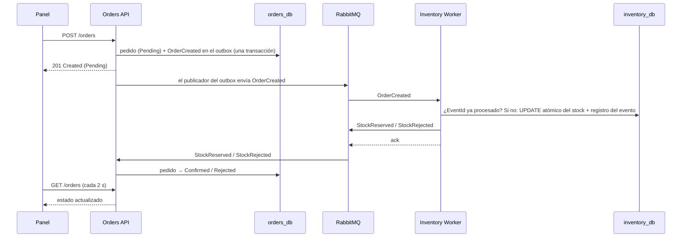

# OrderFlow

Sistema de pedidos con reserva de inventario asíncrona. Una **Orders API** recibe pedidos y un
**Inventory Worker** reserva el stock; se comunican por eventos a través de **RabbitMQ**. Un panel
web en **React** permite crear pedidos y ver cómo cambian de estado en vivo.

Stack: .NET 8 · PostgreSQL 16 · RabbitMQ 4 · React 19 + TypeScript · Docker Compose.

## Cómo levantarlo

**Requisito:** Docker Desktop.

```bash
docker compose up --build
```

| Qué | Dónde |
|---|---|
| Panel web | http://localhost:3000 |
| API (a través del panel) | http://localhost:3000/api/orders |
| Estado de la API | http://localhost:3000/api/health |
| RabbitMQ (administración) | http://localhost:15672 (usuario `orderflow`, contraseña `orderflow_dev`) |

El primer arranque tarda unos minutos (compila las imágenes). Las migraciones y los datos
iniciales se aplican solos al arrancar cada servicio.

**¿Algún puerto ocupado?** Copia `.env.example` a `.env` y cambia el puerto que choque
(por ejemplo `FRONTEND_HOST_PORT=3001`). No hace falta tocar el `docker-compose.yml`.

Para empezar de cero (borra los datos): `docker compose down -v`.

### Demo en 1 minuto

Stock inicial:

| SKU | Producto | Stock |
|---|---|---|
| ABC-01 | Teclado mecánico | 100 |
| ABC-02 | Mouse inalámbrico | 50 |
| ABC-03 | Monitor 27 pulgadas | **3** (bajo a propósito, para probar rechazos) |

1. Pedido de 2 × ABC-01 → aparece **Pendiente** y en ~2 s pasa a **Confirmado**.
2. Pedido de 5 × ABC-03 → pasa a **Rechazado**, con el motivo (“Stock insuficiente…”).
3. Formulario vacío → errores debajo de cada campo.

## Arquitectura

```
┌──────────┐  /api   ┌──────────────┐  order.created   ┌──────────────────┐
│ Frontend │ ──────► │  Orders API  │ ───────────────► │ Inventory Worker │
│ (nginx)  │         │              │ ◄─────────────── │                  │
└──────────┘         └──────┬───────┘  stock.reserved  └────────┬─────────┘
                            │          stock.rejected           │
                       orders_db          (RabbitMQ)        inventory_db
                            └──────────── PostgreSQL ───────────┘
```

| Servicio | Responsabilidad |
|---|---|
| `frontend` | Panel React servido por nginx. nginx redirige `/api/*` a la API, así el navegador nunca sale de su origen (sin CORS). |
| `orders-api` | Crea y consulta pedidos, publica `OrderCreated` y aplica `StockReserved`/`StockRejected`. Dueño del **catálogo** (qué se puede vender). |
| `inventory-worker` | Consume `OrderCreated`, reserva el stock y responde. Dueño del **stock** (cuánto hay). No expone HTTP. |
| `postgres` | Una base por servicio (`orders_db`, `inventory_db`) en la misma instancia. |
| `rabbitmq` | Exchange `orderflow.events` (tipo topic). Colas `inventory.order-created` (binding `order.created`) y `orders.stock-results` (binding `stock.*`). |

### Flujo de un pedido



### Endpoints

| Método | Ruta | Respuesta |
|---|---|---|
| `POST` | `/orders` | `201` con el pedido en `Pending` · `400` (ProblemDetails) con los errores por campo |
| `GET` | `/orders` | Lista de pedidos, del más reciente al más antiguo |
| `GET` | `/orders/{id}` | `200` con el pedido · `404` si no existe |
| `GET` | `/products` | Catálogo (lo usa el selector del formulario) |
| `GET` | `/health` | Estado del proceso (lo usa el healthcheck de Docker) |

Validación de `POST /orders`: `clienteNombre` no vacío, `sku` existente en el catálogo, `cantidad`
entre 1 y 100. Se devuelven todos los errores juntos, no solo el primero.

## Decisiones de arquitectura

- **Outbox en Orders.** Guardar el pedido y publicar el evento son dos sistemas distintos, sin
  transacción común. Con el outbox, el evento se guarda en la misma transacción que el pedido y un
  proceso en segundo plano lo publica después, reintentando hasta lograrlo. Nunca hay un pedido sin
  evento ni un evento sin pedido.
- **Consumidores idempotentes.** RabbitMQ entrega *at-least-once* y el outbox también puede
  reenviar, así que los duplicados son esperables:
  - **Inventory** registra cada `EventId` en `ProcessedEvents` (clave primaria) en la misma
    transacción que el descuento. Un duplicado no descuenta y reenvía la respuesta original (mismo
    `MessageId`).
  - **Orders** se apoya en la máquina de estados: confirmar un pedido ya confirmado no hace nada.
- **Reserva de stock atómica.** `UPDATE ... SET Disponible = Disponible - n WHERE Sku = x AND
  Disponible >= n`. Evita la condición de carrera de leer, decidir y escribir por separado. Además,
  un check constraint impide stock negativo.
- **Catálogo en Orders, stock en Inventory.** Orders valida que el SKU exista sin consultar a
  Inventory, lo que rompería el desacople. Ambos se siembran con los mismos SKUs; en producción el
  catálogo se sincronizaría por eventos.
- **`RabbitMQ.Client` directo, sin MassTransit.** Para que el outbox, los acks y la idempotencia se
  vean en el código. En producción evaluaría MassTransit.
- **PostgreSQL en vez de una base en memoria.** La idempotencia depende de transacciones y
  restricciones reales, y los datos sobreviven a reinicios.
- **Minimal APIs + modelo de dominio rico.** Cinco endpoints no justifican controllers. El estado
  del pedido solo cambia con `Confirm()`/`Reject()`, que validan las transiciones.
- **Frontend sin librería de estado.** `useState` + dos hooks (`useOrders`, `useProducts`). El
  frontend siempre llama a `/api`: en desarrollo lo redirige el proxy de Vite y en Docker, nginx.
- **Imágenes Docker multi-stage sobre Alpine.** Se compila con la imagen del SDK y la imagen final
  solo lleva el runtime (API 179 MB, Worker 144 MB, frontend 102 MB con nginx). Los servicios .NET
  corren con un usuario sin privilegios.
- **Configuración por variables de entorno.** El código no contiene cadenas de conexión ni
  credenciales. En desarrollo local se usan *user-secrets*; en Docker, las variables del compose.

### Garantías de mensajería

| Mecanismo | Dónde | Para qué |
|---|---|---|
| **Publisher confirms** | Outbox de Orders y respuestas del Worker | Un mensaje se da por publicado solo cuando RabbitMQ confirma que lo recibió. Recién ahí se marca el outbox como procesado (o se hace ack del mensaje de entrada). |
| **`mandatory: true`** | Mismos dos publicadores | Si ninguna cola escucha esa routing key, el broker devuelve el mensaje y se trata como error, en vez de descartarlo en silencio. |
| **Exchange y colas durables + mensajes persistentes** | Toda la topología | Sobreviven a un reinicio de RabbitMQ. |
| **Ack manual** (`autoAck: false`) | Los dos consumidores | Se confirma solo después de guardar en la base y publicar la respuesta. Si algo falla antes, el mensaje se vuelve a entregar. |
| **`prefetchCount: 1`** | Los dos consumidores | Un mensaje a la vez por consumidor. |

## Manejo de fallos

| Escenario | Qué pasa |
|---|---|
| **RabbitMQ caído cuando Orders publica** | El pedido se crea igual (`201`). El evento queda en el outbox; el publicador reintenta cada 5 s y lo envía cuando el broker vuelve. |
| **Inventory no responde** | El pedido queda en `Pending`. `OrderCreated` espera en la cola durable de Inventory (o en el outbox, si la cola todavía no existe) y se procesa cuando el Worker vuelve. |
| **Nadie escucha una routing key** | Por `mandatory`, la publicación falla: el evento sigue en el outbox, o el mensaje de entrada no se confirma y se reintenta. |
| **Error transitorio en un consumidor** (por ejemplo, la base caída) | No se hace ack: tras 5 s el mensaje se devuelve a la cola (`nack` con `requeue`) y se reintenta. |
| **Mensaje inválido o transición imposible** (por ejemplo, `Confirmed → Rejected`) | Se descarta (`reject` sin `requeue`) y se registra como error, para no bloquear la cola. |
| **Respuesta de stock para un pedido inexistente** | Se registra una advertencia y se confirma el mensaje. |
| **Evento duplicado** | Se ignora (ver idempotencia): el stock no se descuenta dos veces. |
| **API caída (panel)** | El panel conserva los últimos datos, muestra un aviso y se recupera solo cuando la API vuelve. |

## Demostrar la idempotencia

**Con tests:** `El_mismo_evento_procesado_dos_veces_descuenta_stock_una_sola_vez` (ver Tests).

**A mano**, con el sistema corriendo y algún pedido ya procesado, se pueden volver a publicar todos
los eventos del outbox:

```bash
docker compose exec postgres psql -U orderflow -d orders_db -c "UPDATE \"OutboxMessages\" SET \"ProcessedAt\" = NULL;"
```

Los logs del Worker (`docker compose logs -f inventory-worker`) muestran
`duplicado: no se descuenta stock`, y el stock no cambia:

```bash
docker compose exec postgres psql -U orderflow -d inventory_db -c "SELECT * FROM \"Stock\";"
```

> En PowerShell las comillas internas pueden perderse. Alternativa: entrar con
> `docker compose exec postgres psql -U orderflow -d orders_db` y escribir el SQL ahí.

## Tests

**Requisitos:** .NET 8 SDK y Docker en ejecución.

```bash
dotnet test
```

Los tests de Inventory levantan un PostgreSQL temporal con **Testcontainers**, porque el `UPDATE`
atómico y las transacciones no se pueden probar con una base en memoria. Resultado esperado:
5 pruebas correctas

| Test | Cubre |
|---|---|
| `Confirm_es_idempotente_si_llega_el_mismo_resultado_dos_veces` | Transiciones + idempotencia en Orders |
| `Reject_sobre_un_pedido_confirmado_lanza_excepcion` | Transiciones inválidas |
| `Devuelve_todos_los_errores_juntos_cuando_todos_los_campos_son_invalidos` | Validación |
| `El_mismo_evento_procesado_dos_veces_descuenta_stock_una_sola_vez` | Idempotencia del Worker |
| `Sin_stock_suficiente_rechaza_y_no_descuenta` | Rechazo sin descontar |

## Desarrollo local (sin Docker para los servicios)

**Requisitos:** .NET 8 SDK y Node.js 22+.

```bash
docker compose up -d postgres rabbitmq

dotnet user-secrets set "ConnectionStrings:OrdersDb" "Host=localhost;Port=5433;Database=orders_db;Username=orderflow;Password=orderflow_dev" --project src/Orders.Api
dotnet user-secrets set "RabbitMq:User" "orderflow" --project src/Orders.Api
dotnet user-secrets set "RabbitMq:Password" "orderflow_dev" --project src/Orders.Api

dotnet user-secrets set "ConnectionStrings:InventoryDb" "Host=localhost;Port=5433;Database=inventory_db;Username=orderflow;Password=orderflow_dev" --project src/Inventory.Worker
dotnet user-secrets set "RabbitMq:User" "orderflow" --project src/Inventory.Worker
dotnet user-secrets set "RabbitMq:Password" "orderflow_dev" --project src/Inventory.Worker

dotnet run --project src/Orders.Api          # Swagger en http://localhost:5236/swagger
dotnet run --project src/Inventory.Worker
cd frontend && npm install && npm run dev    # http://localhost:5173
```

Swagger solo se habilita en el entorno `Development`, no en Docker. No conviene correr la API local
y la de Docker a la vez: consumirían de las mismas colas.

## Trade-offs asumidos

- **Migraciones al arrancar.** Simple para la prueba; con varias réplicas competirían entre sí.
- **Una instancia de Postgres** para las dos bases, para ahorrar recursos en local.
- **`prefetchCount = 1`.** Procesamiento simple y ordenado, pero un mensaje que se reintenta
  retrasa a los siguientes.
- **Polling cada 2 s** en vez de tiempo real: suficiente para el caso de uso.
- **Contratos compartidos** (`OrderFlow.Contracts`): acoplan los servicios en compilación, algo
  aceptable en un monorepo.
- **`POST /orders` no es idempotente:** un doble envío crea dos pedidos. El panel lo mitiga
  deshabilitando el botón mientras envía.
- **Código de conexión a RabbitMQ duplicado** entre los dos servicios (opciones y estructura de los
  consumidores). A esta escala preferí eso a una librería compartida que acople los servicios.
- **El healthcheck solo verifica que el proceso esté vivo**, no que la base y RabbitMQ respondan.

## Qué haría distinto con más tiempo

- **Dead-letter queue** para los mensajes que fallan N veces, en vez de solo descartarlos y registrarlos.
- **Header `Idempotency-Key`** en `POST /orders` para evitar pedidos duplicados por reintentos del cliente.
- **Outbox preparado para varias réplicas** (`SELECT ... FOR UPDATE SKIP LOCKED`) y migraciones
  como un paso de despliegue separado.
- **Concurrencia optimista** en los pedidos (columna `xmin` de Postgres).
- **Health checks de readiness** que verifiquen la base y RabbitMQ.
- **Observabilidad:** logs estructurados y trazas distribuidas con OpenTelemetry, correlacionadas por `OrderId`.
- **SignalR** para actualizar el panel en tiempo real.
- **Paginación** en `GET /orders` y **tests de frontend**.
- **Sincronización del catálogo por eventos** (`ProductCreated`) en vez de un seed duplicado.
- **Kubernetes:** no lo incluí porque todavía no tengo experiencia práctica suficiente para diseñarlo
  con criterio. Preferí entregar solo lo que puedo explicar y defender.

## Uso de asistentes de IA

Usé un asistente de IA como tutor durante el desarrollo: para discutir patrones (outbox,
idempotencia), revisar errores y proponer código. Cada parte la ejecuté, la probé y la puedo
explicar y modificar.
